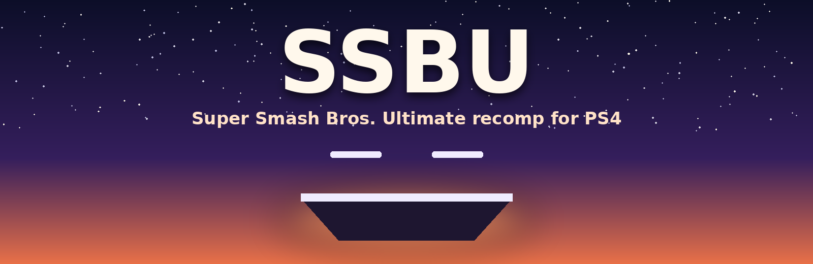

  

  
  
  
  
  

<h3 align="center">Super Smash Bros. Ultimate, running natively on the PS4.</h3>

  <a href="#getting-started"><b>Getting started</b></a> ·
  <a href="#controls">Controls</a> ·
  <a href="#the-l3--r3-menu">L3 + R3 menu</a> ·
  <a href="#performance">Performance</a> ·
  <a href="#faq">FAQ</a> ·
  <a href="docs/BUILDING.md">Building</a> ·
  <a href="CREDITS.md">Credits</a>

---

## Overview

SSBU brings [WindowSmash](https://github.com/SNO2207/WindowSmash), SNO2207's static recompilation of Super Smash
Bros. Ultimate, to jailbroken PS4 consoles. There's no emulator: the game's AArch64 code is translated to C ahead of
time and compiled for the PS4's CPU, and WindowSmash's own runtime gives it what it expects from a Switch: graphics,
sound, controllers and files.

The runtime draws with Direct3D 11. On the PS4 that goes through [DXVK](https://github.com/doitsujin/dxvk), built
for the console, onto Vulkan, through Mesa's RADV driver ported to submit work straight to the PS4's AMD GPU (the
same driver as [Crema](https://github.com/iHaiDeeZ/Crema) and [SMW](https://github.com/iHaiDeeZ/SMW)).

It installs as an app on the home screen and plays with up to four DualShock 4 controllers. **L3 + R3** opens a
menu for the resolution, FSR upscaling, the frame counter and button mapping.

You bring your own game: nothing copyrighted is in this repository. No game code, assets, shaders or keys. There are
no releases either: the package is built from your own dump (see [Getting started](#getting-started)).

> [!WARNING]
> **Experimental.** Matches are playable, with the frame rate and hitches described under
> [Performance](#performance). Expect rough edges.

## Highlights

**The whole game, natively**
- The recompiled game code on the PS4's cores, with no interpreter or JIT in between. The game's 98 extra
  modules (one per fighter, and more) load on demand, the way they do on a Switch.
- The game's version 13.0.2 with every DLC fighter you own, its movies (VP9) and its music (Opus).
- Saves in `/data/SSBU/save`, kept across updates.

**Made for the PS4's hardware**
- Every shader of the game is compiled on the PC ahead of time, into the PS4 GPU's own code, so a new fighter or
  stage doesn't have to wait for the console's CPU to compile it.
- The shaders you've used before are prepared while the game boots, so matches start without hitches.
- FidelityFX Super Resolution 1 renders below 1080p and upscales, for busy stages.
- Memory is mapped as the game touches it: the game asks for tens of gigabytes and uses a few.

**Couch-friendly**
- Up to four players, each on their own DualShock 4 and PS4 user, with rumble.
- Any Switch button on any DualShock 4 button, changed from the L3 + R3 menu while you play.
- A frame counter with a graph of frame times, when you want one.

**When something goes wrong**
- Logs, crash and freeze reports in `/data/SSBU`, and a 10-second profiler in the L3 + R3 menu.

## Getting started

**You need:**
- a jailbroken PS4 with **GoldHEN** (developed on a launch-model PS4), and an FTP connection to it;
- about **50 GB free** on the PS4 (the game data is ~23 GB, the package as much again while it installs);
- a PC with **Windows 10 or 11 and WSL 2** (Ubuntu), 16 GB of RAM and ~150 GB free;
- your own **Super Smash Bros. Ultimate** dump: the base game (`.xci` or `.nsp`), update **13.0.2**, any DLC you own,
  and your `prod.keys` and `title.keys`, all from your own Switch.

The package is built from your dump because its `eboot.bin` is mostly the game's own code, recompiled. That's why
there are no releases, and why you must never share yours.

1. **Build it**, following **[docs/BUILDING.md](docs/BUILDING.md)**: your dump is unpacked, recompiled to C,
   compiled for the PS4, and its shaders are compiled for the PS4's GPU. Count on several hours the first time.
2. **Choose a package:**
   - **`SSBU-vXX.YY-full.pkg`** (~24 GB) carries the game data too: one file to install and nothing else to copy.
   - **`SSBU-vXX.YY.pkg`** (~250 MB) is the program alone: the game data then goes to **`/data/SSBU`** over FTP
     (`scripts/upload-data.py`, which resumes where it stopped).
3. **Copy the package** to `/data/pkg` on the PS4 (`scripts/upload-to-console.sh`, or FileZilla), install it with
   GoldHEN's **Package Installer** and start **SSBU** from the home screen.

The first start takes a few minutes while the shader caches are set up; later starts are quicker.

**Updating SSBU:** build the newer version and install it on top of the old one. Your saves, settings and caches in
`/data/SSBU` stay. A program-only package installed over a full one removes the data inside the package: keep the
data in `/data/SSBU` if you switch between the two.

## Controls

The DualShock 4's buttons sit where the Switch's are, so A is on the right and B at the bottom.

| DualShock 4 | Switch |
|---|---|
| Circle | A |
| Cross | B |
| Triangle | X |
| Square | Y |
| L1 / R1 | L / R |
| L2 / R2 | ZL / ZR |
| OPTIONS | + |
| Touchpad click | − |
| Left / right stick | Left / right stick |
| L3 / R3 | Stick buttons |
| D-pad | D-pad |
| **L3 + R3** | **The SSBU menu** (or hold OPTIONS and the touchpad for a second) |

Each signed-in PS4 user is a player, in the order they signed in. A controller switched on mid-game is found within
half a second.

## The L3 + R3 menu

Press **L3 + R3** while playing. **L1 / R1** switch between its pages (Graphics, Controllers, Online, Game),
**Up / Down** choose, **Left / Right** change a value, **Circle** selects and **Cross** closes the menu. Your
choices are saved.

| Item | What it does | Applies |
|---|---|---|
| Resolution | 100% (1920 x 1080), 85%, 75%, 67% (1280 x 720) or 50% (960 x 540) | Next start |
| Upscaling | FSR 1 (edges kept clean, then sharpened) or a plain bilinear stretch | At once |
| FSR sharpness | Maximum, high (the default), medium or low | At once |
| Frame rate in the corner | The frame rate and a graph of frame times | At once |
| Save a profile (10 s) | Records where the time goes for 10 seconds, to `/data/SSBU/profiles` | At once |
| Restart the game | Starts again, at the resolution chosen. A match in progress is lost | |
| Controllers | Per controller: its player, face-button layout, stick dead zone, rumble strength, trigger press point and any Switch button on any DualShock 4 button | At once |

## Performance

Measured on a launch-model PS4 at 100% resolution, with every diagnostic off:

| Where | Frames per second |
|---|---|
| Menus, character select | 60 |
| Most stages | 60, with short dips |
| Busy stages (lots moving around) | 30–43 |

The PS4's CPU is the limit: in busy scenes, turning the game's Switch GPU commands into Direct3D 11 and then Vulkan
takes 17–25 ms a frame. Lowering the resolution doesn't help there, since the GPU isn't the bottleneck.

The first match with a fighter or stage you haven't played before can stutter while its shaders are loaded. They're
remembered, and prepared while the game boots from then on, so the next match is smoother.

## Settings

The L3 + R3 menu covers the everyday settings. For the rest, put `NAME=value` lines in **`/data/SSBU/env.txt`**
(`#` starts a comment); they're read when the game starts:

| Setting | What it does |
|---|---|
| `SSBU_RENDER_SCALE=0.75` | The resolution, as in the menu (1, 0.85, 0.75, 0.6667, 0.5) |
| `SSBU_UPSCALER=fsr` | `fsr` or `bilinear` |
| `SSBU_FSR_SHARPNESS=0.2` | 0 (the sharpest) to 2 (hardly any) |
| `SSBU_OVERLAY=1` | The frame counter |
| `SSBU_SEVENTH_CORE=1` | Lets the game use the PS4's 7th core too (off by default: one freeze was seen with it) |
| `SSBU_SHADER_PREWARM_MAX=3000` | How many of the shaders you've used are prepared while the game boots |
| `SSBU_AUTO_PROFILE=1` | Saves profiles by itself when the frame rate drops |

DXVK reads its own settings from `/data/SSBU/dxvk.conf`.

## Your files

Everything the game creates sits in **`/data/SSBU/`**:

- `save/`: your saves
- `dump/`: the game data, when it isn't in the package (the game, its update, your DLC, the fighter modules, fonts and
  the shader pack)
- `dump/shadercache-used.txt`: the shaders you've used, in the order they appeared, prepared at boot
- `dump/shadercache-new/`: shaders the PS4 had to compile itself, for the next shader pack
- `dxvk/`, `mesa/`: DXVK's and RADV's shader caches
- `env.txt`, `dxvk.conf`: settings (see [Settings](#settings))
- `ssbu.log` (and `ssbu.old.log`, the run before), `dxvk.log`, `boot-trace.log`: logs
- `crash.log`, `hang.log`, `reports/`: crash and freeze reports
- `profiles/`: profiles saved from the L3 + R3 menu

## FAQ

**Can I download the package?**
No. It's built from your own dump, and it holds the game's code. Never share yours.

**Will it work on a PS4 Pro?**
It hasn't been tested on one. The Pro's GPU is a different chip from the shader pack's, so at best every shader is
compiled again on the console the first time. Reports are welcome.

**Can I install my package on my other PS4?**
Yes, on the same model, with the same jailbreak. Copy `/data/SSBU/save` over to bring your saves along.

**Why does the first match stutter?**
A fighter or stage you haven't played yet needs its shaders loaded. The second match with it is smoother.

**Why do busy stages run at 30–40?**
The PS4's CPU can't turn the game's GPU commands into Vulkan any faster yet. Lowering the resolution won't help.

**Online play?**
WindowSmash's Online page is there, but it hasn't been tested on the PS4.

**How do I report a bug?**
[Open an issue](https://github.com/iHaiDeeZ/SSBU/issues). Attach `ssbu.log`, `boot-trace.log` and, if there is
one, `crash.log`, `hang.log` or the newest file in `reports/`, and mention your PS4 model, firmware and the SSBU
version. For slowdowns, a profile from the L3 + R3 menu helps.

## Good to know

- Developed against game version **13.0.2**. Other versions are untested.
- Only the original PS4 has been tested so far.
- Save states aren't supported; the game saves as it does on a Switch.
- The data folder holds your game: keep it on your console.

## Thanks

- **[WindowSmash](https://github.com/SNO2207/WindowSmash)** by **SNO2207**: the recompiler and runtime this port
  is built on
- **[DXVK](https://github.com/doitsujin/dxvk)**: Direct3D 11 on Vulkan
- **[Mesa](https://mesa3d.org)**: the RADV Vulkan driver that draws every frame
- **[vkd3d-shader](https://gitlab.winehq.org/wine/vkd3d)**: HLSL to DXBC on the console
- **[AMD FidelityFX Super Resolution 1](https://github.com/GPUOpen-Effects/FidelityFX-FSR)**: the upscaler
- **[OpenOrbis](https://github.com/OpenOrbis)** and **[PacBrew](https://github.com/PacBrew)**: the PS4 toolchains
- **[LibOrbisPkg](https://github.com/maxton/LibOrbisPkg)**: the packages
- **[GoldHEN](https://github.com/GoldHEN/GoldHEN)**: the homebrew enabler it runs under

Everyone involved, with licences, is listed in **[CREDITS.md](CREDITS.md)**.

## License and disclaimer

This repository's own code is released under the **MIT License**. See [LICENSE](LICENSE). The PS4 layer is
shared with [SMW](https://github.com/iHaiDeeZ/SMW) and Crema. `patches/windowsmash-ps4.patch` changes WindowSmash,
which has no project-wide licence of its own: it's a patch to apply to your own checkout, not a copy of WindowSmash.

This is a fan-made project with no ties to Nintendo, Sony Interactive Entertainment or the WindowSmash project.
Super Smash Bros. Ultimate and Nintendo Switch are trademarks of Nintendo; PlayStation and PS4 are trademarks of
Sony Interactive Entertainment. Please only play games you own. This project won't help you find or share game
files.
